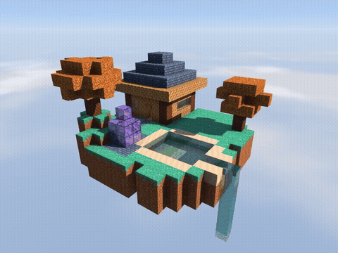
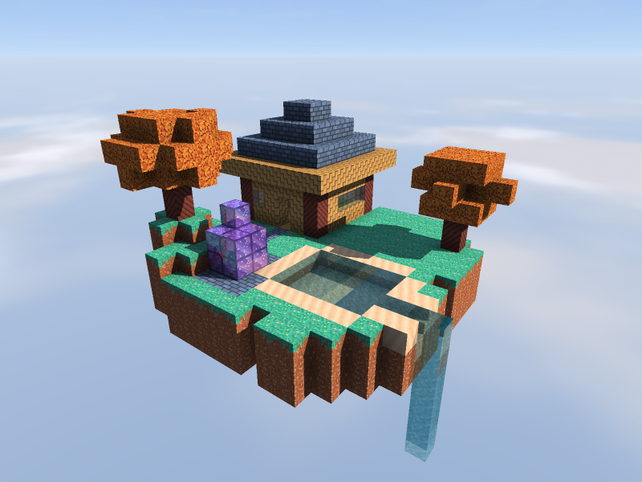
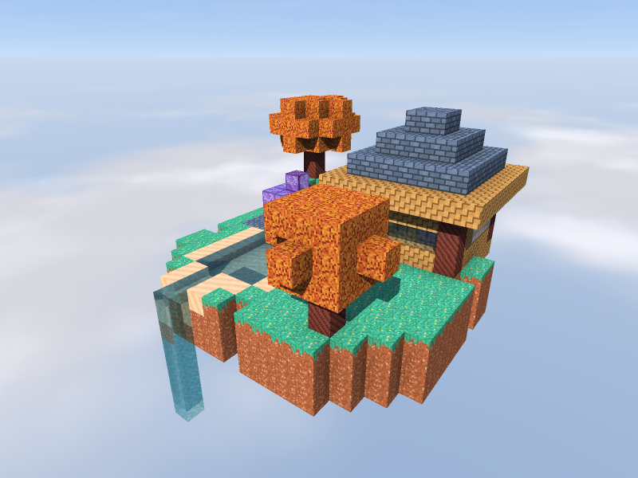
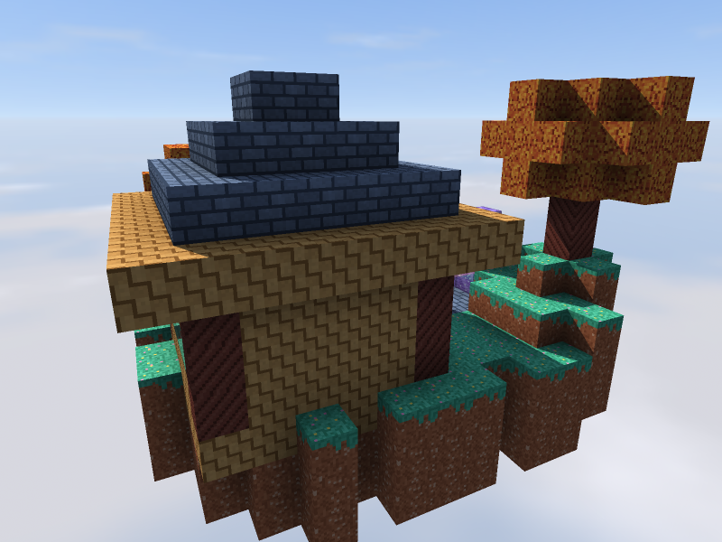
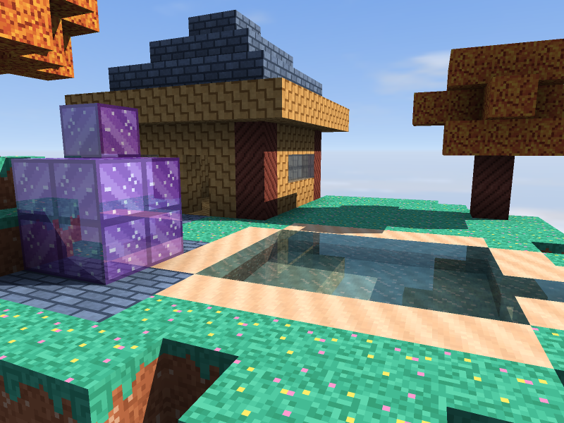

# Proyecto 2 · Diorama con Raytracing

Diorama de bloques renderizado en tiempo real con un raytracer crado en Rust: una isla flotante de otoño sobre un mar de nubes, con una casa de parqué y techo de pizarra, ventanas de vitral, un estanque turquesa con cascada, árboles de hojas naranjas y un monumento de amatista.

## Video

https://github.com/Guate27/Proyecto-2-Graficas/raw/main/media/demo.mp4



## Capturas

| Frente | Lateral |
|---|---|
|  |  |
| **Atrás** | **De cerca** |
|  |  |

## Cómo ejecutarlo

```
cargo run --release
```

### Controles

| Tecla | Acción |
|---|---|
| ← → (o A / D) | Girar alrededor del diorama |
| ↑ ↓ | Inclinar la cámara |
| W / S o rueda del mouse | Acercar / alejar |
| Espacio | Activar o desactivar el giro automático |
| R | Regresar la cámara a la posición inicial |
| Esc | Salir |

Mientras la cámara se mueve se lanza un rayo por píxel. Al detenerse, la imagen se recalcula con 4 rayos por píxel (antialiasing) para suavizar los bordes.

### Modos sin ventana

```
cargo run --release -- --capturas      # guarda 4 vistas en capturas/
cargo run --release -- --video 240     # guarda una vuelta completa en frames/
```

## Qué implementa

| Requisito | Implementación |
|---|---|
| Cubos texturizados | Cada bloque es un cubo de 1×1×1 en una cuadrícula 3D. La intersección rayo-cubo usa el método de las franjas (slabs) y calcula la normal y las coordenadas de textura de la cara golpeada. |
| Materiales | 10 materiales, cada uno con su propia textura y sus propios valores de albedo, specular, transparencia, reflectividad e índice de refracción (tabla abajo). |
| Refracción | Agua (índice 1.33) en el estanque y la cascada, y vidrio (1.5) en las ventanas de la casa. Usa la ley de Snell, reflexión interna total y Fresnel (aproximación de Schlick). |
| Reflexión | Amatista (reflectividad 0.30), además del reflejo de Fresnel en agua y vidrio. |
| Skybox | Cubemap de 6 imágenes BMP (cielo con nubes, sol y un mar de nubes abajo). El sol del skybox coincide con la dirección de la luz. |
| Rotación y zoom | Cámara orbital alrededor del centro del diorama con zoom limitado. |
| Iluminación | Luz direccional del sol con modelo difuso (Lambert) y especular (Phong), sombras con rayos de sombra (el agua y el vidrio dejan pasar parte de la luz) y oclusión ambiental en las esquinas. |
| Rendimiento | Recorrido de la cuadrícula celda por celda (DDA) en lugar de revisar todos los cubos, y render repartido entre todos los núcleos con hilos de la librería estándar. |

### Materiales

| Material | Texturas | Albedo | Specular | Transparencia | Reflectividad | Índice |
|---|---|---|---|---|---|---|
| Pasto | turquesa con flores arriba, musgo que cae por los lados, tierra abajo | 0.90 | 0.05 | 0.00 | 0.00 | 1.00 |
| Tierra | terracota con piedritas | 0.88 | 0.03 | 0.00 | 0.00 | 1.00 |
| Piedra | ladrillos de pizarra azulada | 0.85 | 0.20 | 0.00 | 0.00 | 1.00 |
| Arena | durazno con ondas de viento | 0.92 | 0.08 | 0.00 | 0.00 | 1.00 |
| Tronco | corteza rojiza a los lados, anillos arriba y abajo | 0.85 | 0.10 | 0.00 | 0.00 | 1.00 |
| Tablones | parqué en espiga color miel | 0.88 | 0.18 | 0.00 | 0.00 | 1.00 |
| Hojas | hojas de otoño naranjas y rojas | 0.82 | 0.06 | 0.00 | 0.00 | 1.00 |
| Agua | turquesa con líneas de luz | 0.30 | 0.90 | 0.70 | 0.08 | 1.33 |
| Vidrio | vitral de cuatro paneles | 0.15 | 1.00 | 0.82 | 0.08 | 1.50 |
| Amatista | cristal violeta facetado | 0.75 | 1.00 | 0.00 | 0.30 | 1.00 |

## Estructura

```
src/
├── main.rs           ventana, controles y modos de captura
├── raytracer.rs      cast_ray, sombreado, reflexión, refracción, Fresnel, render con hilos
├── scene.rs          cuadrícula de bloques, recorrido DDA, sombras y oclusión ambiental
├── diorama.rs        materiales y construcción de la isla
├── cube.rs           intersección rayo-cubo (método de las franjas)
├── ray_intersect.rs  datos de un choque y el trait RayIntersect
├── camera.rs         cámara orbital con zoom
├── material.rs       parámetros de cada material
├── light.rs          luz direccional del sol
├── skybox.rs         cubemap del cielo
├── texture.rs        lector de BMP y muestreo de texturas
├── color.rs          color con canales decimales
└── framebuffer.rs    imagen en memoria y escritura de BMP
assets/
├── textures/         texturas 16×16 de los bloques (BMP)
├── skybox/           6 caras del cielo (BMP)
└── generar_assets.py script que generó las texturas y el skybox
```

## Librerí
- `minifb`: abrir la ventana y leer el teclado.
- `nalgebra-glm`: el tipo `Vec3` y operaciones de vectores.

